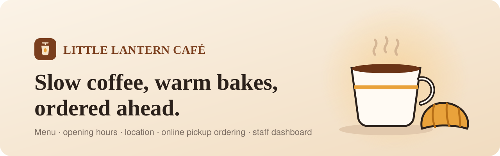
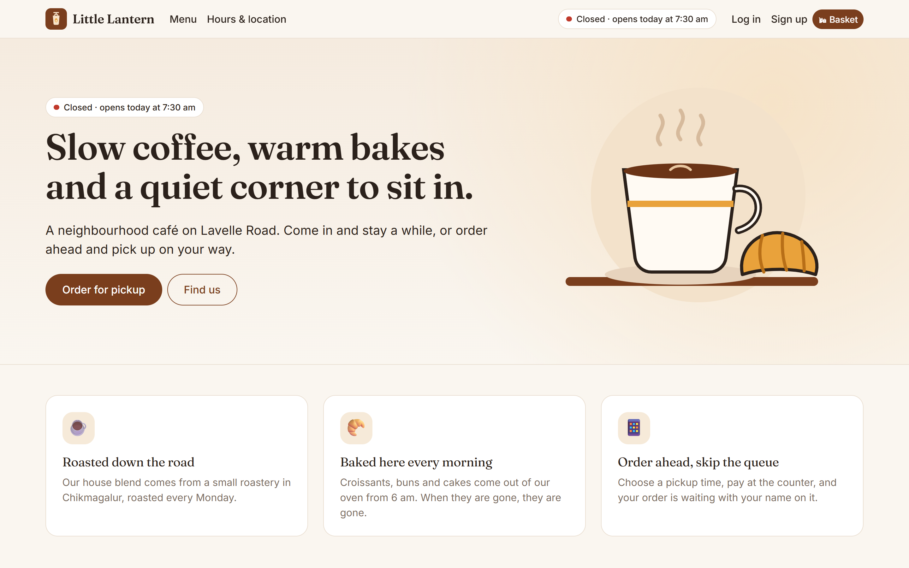
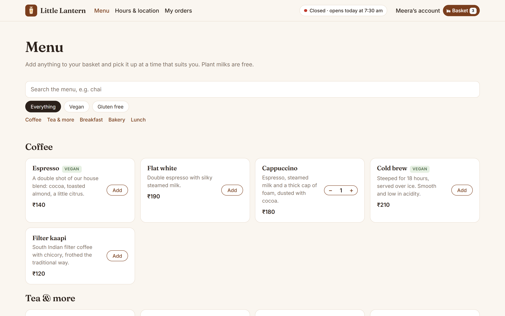
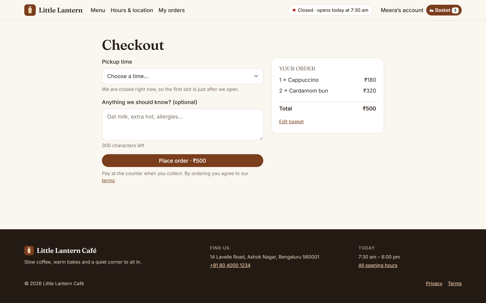
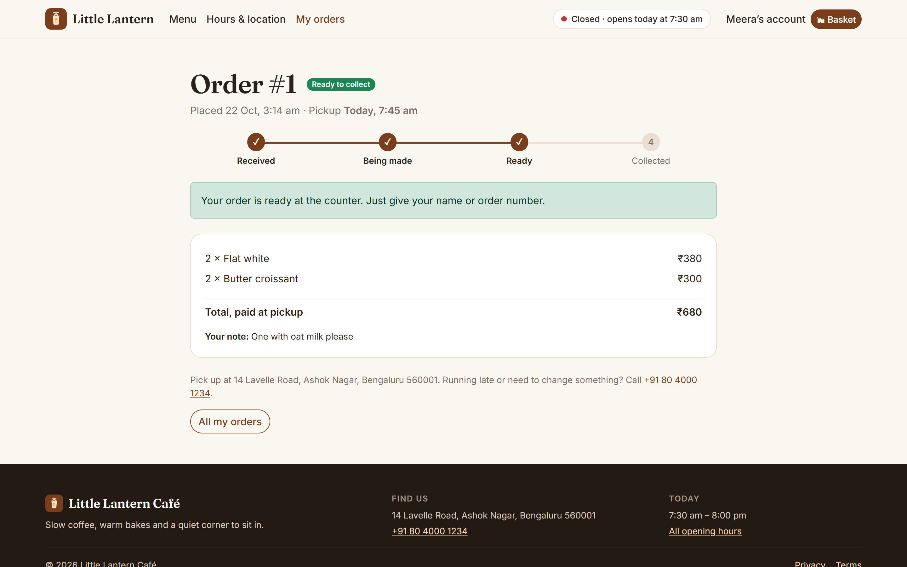
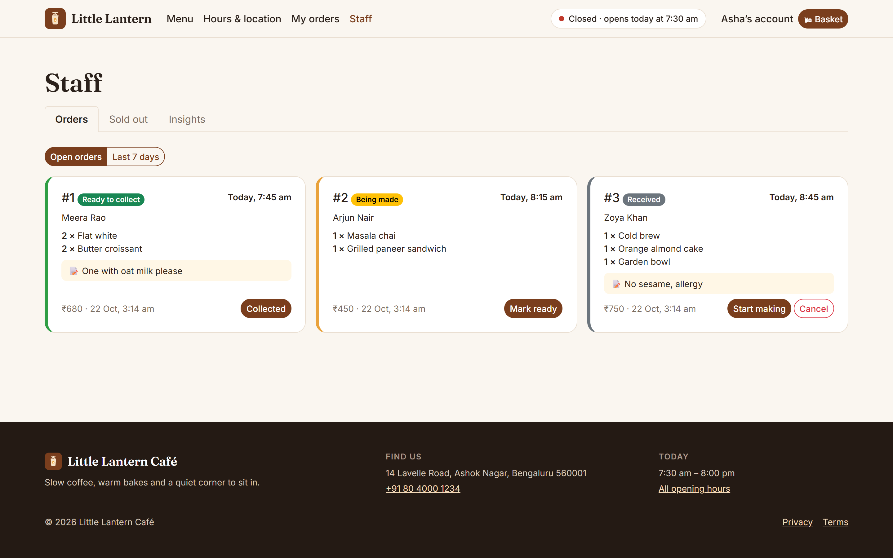
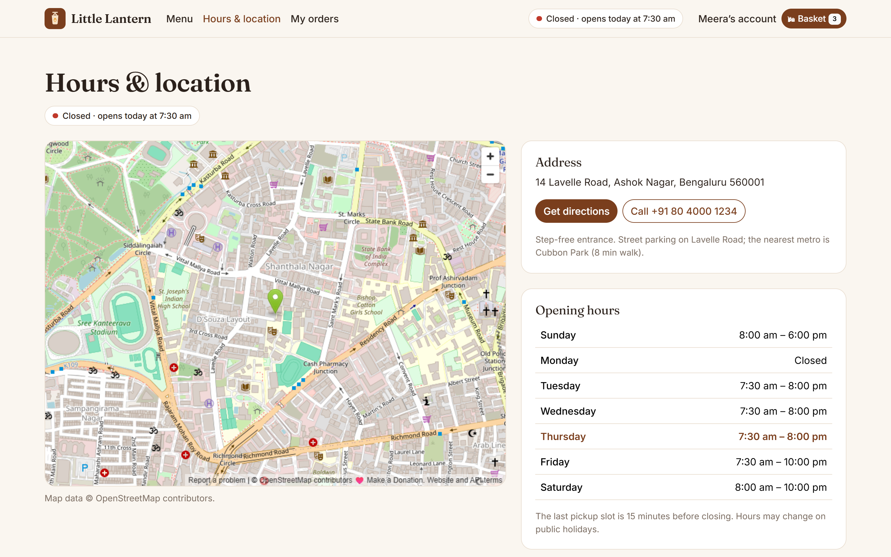
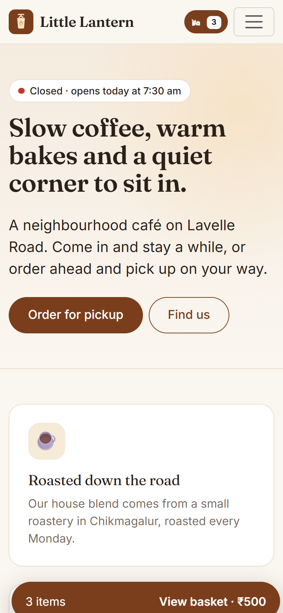
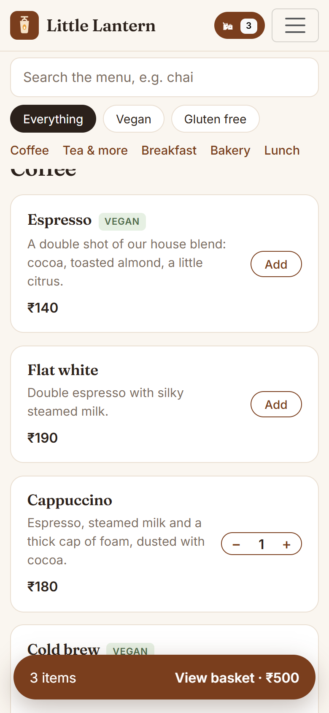

<p align="center">
  
</p>

<p align="center">
  <a href="https://little-lantern-cafe.onrender.com"></a>
  <a href="https://github.com/digvijay165/cafe-website/actions/workflows/ci.yml"></a>
  
  
  
  
  
</p>

<p align="center">
  <b><a href="https://little-lantern-cafe.onrender.com">Open the live site</a></b> ·
  <a href="#-features">Features</a> ·
  <a href="#-screenshots">Screenshots</a> ·
  <a href="#-quick-start">Quick start</a> ·
  <a href="#-deploy">Deploy</a> ·
  <a href="#-production-checklist">Checklist</a> ·
  <a href="#-tech-stack">Stack</a>
</p>

---

**Little Lantern Café** is a complete website for a neighbourhood café. Customers browse the menu, check the opening hours and find the café on a map. They can also **order ahead**: fill a basket, pick a 15-minute pickup slot and pay at the counter. Staff get a live dashboard to move orders from *received* to *ready*, mark items sold out and watch site stats.

> **Live demo:** https://little-lantern-cafe.onrender.com. It runs on Render's free plan, so the first visit after a quiet spell can take about 30 seconds while the server wakes up.

<p align="center">
  
</p>

## ✨ Features

<table>
<tr>
<td width="50%" valign="top">

### ☕ For customers
- **Menu** with search, vegan / gluten-free filters and sold-out labels
- **Hours & location**: live *open now* badge, weekly hours, map and directions
- **Basket** saved on the device, with a floating basket bar on phones
- **Pickup slots** every 15 minutes, worked out in the café's own time zone
- **Order tracking**: *received → being made → ready → collected*, updated live
- Email confirmation for each order; cancel online until the kitchen starts

</td>
<td width="50%" valign="top">

### 🧑‍🍳 For staff and the owner
- **Staff** get a live order board (refreshes every 15 s, with notes and allergies highlighted), one-tap status changes, sold-out switches and site insights
- The **owner dashboard** adds:
  - **Sales overview:** revenue by day, average order and best sellers
  - **Order history:** search by name, email or `#number`, and filter by status and date
  - **Menu editor:** add, edit, delete and reorder items, set prices, dietary tags and new categories
  - **Opening hours, café details** (name, address, phone, map pin), **team roles** and the **customer list**

</td>
</tr>
<tr>
<td width="50%" valign="top">

### 🔐 Accounts & security
- Sign up, log in and log out with hashed passwords and http-only cookies
- Email verification and one-time password-reset links
- **Row level security** in Postgres: customers can only ever see their own orders
- Rate limits on login, signup, reset and ordering; account lockout after failed logins
- Prices are always recalculated on the server; no secrets in the browser

</td>
<td width="50%" valign="top">

### 📱 Polish
- Mobile-first layout, installable as a **PWA**, with the menu and hours available offline
- Loading skeletons, friendly empty states and plain-English error messages
- Custom 404, onboarding for new accounts, privacy and terms pages
- Cookie-free analytics and built-in error tracking
- Accessible: labelled forms, keyboard focus, captions, reduced-motion support

</td>
</tr>
</table>

## 📸 Screenshots

| Menu | Checkout |
| --- | --- |
|  |  |
| **Order tracking** | **Staff dashboard** |
|  |  |

<p align="center">
  
</p>

<p align="center">
  
  &nbsp;&nbsp;
  
</p>

## 🚀 Quick start

You need Node.js 20 or newer. No database to install: locally the app runs on [PGlite](https://pglite.dev), which is real Postgres compiled to WebAssembly.

```bash
git clone https://github.com/digvijay165/cafe-website.git
cd cafe-website
npm install
npm run build
npm start
```

Open http://localhost:3000. Data is saved in `./data/pgdata`. Account and order emails print to the terminal until you add a `RESEND_API_KEY`.

| Command | What it does |
| --- | --- |
| `npm run watch` | Rebuild the frontend on every change (run `npm start` alongside) |
| `npm test` | API tests on a throwaway in-memory Postgres |
| `npm run admin:create` | Create or reset an admin (see below) |
| `npm run backup` / `npm run restore -- <file> --yes` | JSON backup and restore of every table |
| `node scripts/screenshots.js` | Regenerate the screenshots above |

### Owner and staff accounts

| Role | Sees | How to get it |
| --- | --- | --- |
| **Owner** | Owner dashboard + staff board | Email in `OWNER_EMAILS`, or added by another owner under **Team** |
| **Staff** | Order board, sold-out switches, insights | Email in `STAFF_EMAILS`, or added by an owner under **Team** |
| **Customer** | Ordering and their own orders | Everyone else |

Accounts listed in `OWNER_EMAILS` / `STAFF_EMAILS` are promoted when they sign up or next log in. You can also create an account directly; the password is hashed and never saved in a file:

```bash
ADMIN_NAME="Your Name" ADMIN_EMAIL=you@example.com ADMIN_PASSWORD='choose-a-password' npm run admin:create   # ADMIN_ROLE=staff for staff
```

## 🌍 Deploy

<a href="https://render.com/deploy?repo=https://github.com/digvijay165/cafe-website"></a>

The button reads [`render.yaml`](render.yaml) and creates a free web service plus a free PostgreSQL database. When asked, set `OWNER_EMAILS` to your email, then sign up on the live site with that email to get the owner dashboard. Free Render databases expire after 30 days unless upgraded, and free web services sleep after 15 minutes without visits.

**Docker** (NGINX + app + Postgres on one server):

```bash
cp .env.example .env     # set PUBLIC_URL, STAFF_EMAILS, RESEND_API_KEY, POSTGRES_PASSWORD
docker compose up -d --build
```

Serve it over HTTPS in production: the session cookie is `Secure`, so logging in only works over HTTPS. Any Node host with a Postgres `DATABASE_URL` works (Railway, Fly.io, AWS, Azure). Run `npm run build`, then `npm start`.

### Uptime monitoring

`GET /healthz` (HEAD works too) returns `200` and `"status": "ok"` when the app can reach its database, and `503` if the database is unreachable or takes longer than 3 seconds. It skips the API rate limits and is never cached.

```json
{ "status": "ok", "database": "ok", "driver": "postgres", "latencyMs": 4, "uptimeSeconds": 5321, "email": "log" }
```

On [UptimeRobot](https://uptimerobot.com), add an **HTTP(s)** monitor for `https://<your-site>/healthz` with a 5-minute interval. For a stricter check, use a **Keyword** monitor that alerts when `"status":"ok"` is missing. On Render's free plan, these 5-minute checks also stop the site from going to sleep. Render and Docker use the same endpoint for their own health checks.

## ✅ Production checklist

| | Item | Where |
| --- | --- | --- |
| ✅ | Real login and logout | `server/auth.js`: PBKDF2 passwords, http-only SameSite cookie, sessions stored hashed |
| ✅ | Password reset | One-time, 1-hour link; resetting signs out every device |
| ✅ | Email verification | 24-hour link; needed before the first order |
| ✅ | Loading states | Spinners and skeletons (`client/components/ui.jsx`) |
| ✅ | Empty states | Empty basket, no orders, no search results, no open orders |
| ✅ | Clear error messages | Each API error carries a readable message, with per-field errors on forms |
| ✅ | Form validation | In the browser on submit, and again on the server |
| ✅ | Rate limiting | Per IP and per account in the app, plus NGINX `limit_req` on `/api` |
| ✅ | Database backups | `npm run backup` / `restore`; `pg_dump` for large databases |
| ✅ | Row level security | Postgres policies on `orders` and `order_items` ([`server/schema.sql`](server/schema.sql)), covered by tests |
| ✅ | API keys off the frontend | Secrets live only on the server; totals are recalculated there |
| ✅ | Mobile layout | Responsive grid, collapsible navigation, floating basket bar |
| ✅ | Custom 404 page | Unknown URLs return HTTP 404 with a styled page |
| ✅ | Analytics | First-party and cookie-free; respects Do Not Track |
| ✅ | Error tracking | Browser and server errors appear under Staff → Insights |
| ✅ | Privacy policy and terms | `/privacy` and `/terms` (templates: review before launch) |
| ✅ | Delete account button | Account page; needs the password and removes the order history too |
| ✅ | Onboarding flow | `/welcome` explains ordering in three steps after sign-up |
| ✅ | Captions and meta | Alt text, table captions, ARIA labels, page titles, Open Graph tags |

## 🧱 Tech stack

| Layer | Choice | Why |
| --- | --- | --- |
| Frontend | React 18, React Router, **Webpack** | Interactive basket, checkout and live order status |
| UI | **Bootstrap 5** with a custom café theme | Responsive grid and accessible forms out of the box |
| Backend | **Node.js** + Express | One language across the whole app |
| Database | **PostgreSQL**, with **PGlite** locally | Relational data, constraints and row level security |
| Mobile | **PWA** | Installable from the browser; no app-store release needed |
| DevOps | **Docker**, Compose, **NGINX**, GitHub Actions, Render blueprint | One command or one click to run it anywhere |

```
client/            React app (pages, components, styles, PWA files)
server/            Express API, auth, opening-hours logic, schema and seed data
scripts/           admin, backup/restore and screenshot tools
test/              end-to-end API tests
nginx/, Dockerfile, docker-compose.yml, render.yaml   deployment
```

### Scaling later

- **Several app servers:** move the rate-limit counters to **Redis**; [`server/rate-limit.js`](server/rate-limit.js) is the only file to change.
- **Kitchen printer or SMS alerts:** publish an event per order to a queue (**SQS** or **Kafka**) instead of sending it inline.
- **Online payment:** add Razorpay or Stripe Checkout on the server; the order total is already computed there.
